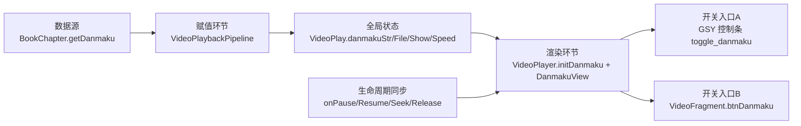
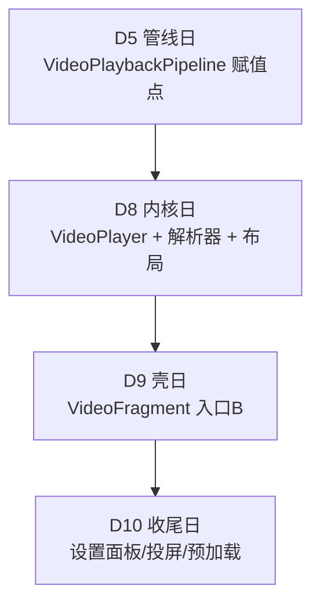

# D4 弹幕保留融合方案：m 播放器壳基座 × 工作区弹幕渲染层

Feature Name: d4-video-fusion-plan
Updated: 2026-10-15
清单编号前置: 2.1.1（gsyVideo 内核融合）/ 2.1.2（播放壳搬入改造）
执行日: D8 / D9 / D10
分支约束: D8 起用独立分支 `feat/video-core`

## Description

D8 将以 m 版 `help/gsyVideo` 10 个文件覆盖工作区同名文件，D9/D10 搬入 m 的播放壳（`VideoPlayerActivity` 重构版 + `VideoFragment`/`VideoPagerAdapter` 等新文件）。本方案回答一个问题：**以 m 为基座时，工作区弹幕渲染层如何零丢失保留**。

分析结论先行：m 版 `VideoPlayer.kt` 对工作区版是严格超集（55 个函数零缺失），弹幕渲染全套实现（`initDanmaku` 等）在 m 中原样保留且增强。弹幕真正的结构性变化只有一处——**弹幕数据赋值点从 `VideoPlay.kt` 迁移到了 `VideoPlaybackPipeline.kt`（D5 搬运范围）**。因此「弹幕保留」的关键动作是保证 D5 管线先行就位，其余环节直接取 m 即可。

## 对比结论（证据矩阵）

### 1. help/gsyVideo 10 个同名文件

m 源锁定 commit `46dc931`，HEAD 验证一致。全部 10 文件无一同名同内容。

| 文件 | 工作区 | m | 差异本质 | 结论 |
|------|-------:|-------:|----------|------|
| BiliDanmukuParser.kt | 286 | 287 | `printStackTrace` → `AppLog.put`（3 处）+ `pointStrArray` 空指针防御 | 取 m |
| DanmakuAdapter.kt | 77 | 78 | 同上 AppLog 化（2 处） | 取 m |
| ChoiceEpisodeDialog.kt | 80 | 94 | 主题统一：容器动态取色 `ThemeStore.backgroundColor` + `UiCorner.panelRadius` 圆角；标题文案资源化；传 `initialSelection` 高亮当前集 | 取 m |
| ChoiceSpeedDialog.kt | 73 | 204 | 重构为内部 `SpeedAdapter`；当前倍速高亮；主题统一 | 取 m |
| Exo2MediaPlayer.kt | 131 | 1505 | 播放内核重度加固：重试上限 `MAX_RETRY=5`、回退阈值、`MAX_7001_REBUILD=2`（GL VideoGraph 重建）、`MAX_4003_REBUILD=1`、HLS KEY 数据源、嗅探协程管理、实例池协作 | 取 m |
| ExoPlayerManager.kt | 277 | 322 | Header 注入修复（CDN 防盗链 404）、音轨 API、播放中动态调速、bufferedPercentage 判空、AppLog | 取 m |
| ExoVideoManager.kt | 74 | 143 | 音轨转发、`releaseSniffResources()`、画质增强效果链 `applyImageEnhanceEffects()`（含 media3 1.10.1 空列表禁注入守卫） | 取 m |
| FloatingPlayer.kt | 170 | 175 | `mReleaseWhenLossAudio = false`（音频焦点丢失改暂停，W3-fix） | 取 m |
| SwitchVideoAdapter.kt | 24 | 74 | 当前集高亮（accentColor + 20% 透明圆角背景）+ 主题统一 | 取 m |
| VideoPlayer.kt | 552 | 949 | 音频焦点 W3-fix、静音、画面比例/音轨、GSY 控件状态机修复、文章模式 ViewPager2 手势兼容、**弹幕增强（见下）** | 取 m |

### 2. ui/video 目录

工作区 4 文件 vs m 16 文件。工作区 4 个同名文件经函数级覆盖性检查**零缺失**（`VideoPlayerViewModel` 6 函数、`ChapterAdapter` 6 函数全覆盖），差异为 m 侧增强。

m 新增 12 文件（D9/D10 搬入）：

| 文件 | 角色 | 建议搬运日 |
|------|------|-----------|
| VideoFragment.kt | ViewPager 页内播放壳（沉浸式悬浮层，弹幕入口挂点） | D9 |
| VideoPagerAdapter.kt | 垂直翻页适配器 | D9 |
| VideoBookPreloader.kt | 预加载 | D10 |
| VideoBookDetailSheet.kt | 详情 Sheet | D10 |
| VideoSettingsPanel.kt / VideoSettingsPanelContent.kt | 播放控制 BottomSheet（Compose） | D10 |
| ImageEnhanceController.kt | 画质增强控制（`VideoPlayer.kt` import 它） | D8 必须先行 |
| RssEpisodeAdapter.kt / RssRouteAdapter.kt | RSS 集数/线路适配（被 `ChapterAdapter`/`VideoFragment`/`VideoPlayerActivity` 引用） | D9 |
| cast/DlnaCastContent.kt / DlnaCastDialog.kt / DlnaCastSettingsPanel.kt | DLNA 投屏 | D10 |
| config/SettingsDialog.kt | 重写为 `ComposeDialogFragment`，旧布局 `dialog_video_settings.xml` 在 m 中已随死资源清理删除 | D10 |

### 3. service/VideoPlayService.kt（594 → 602 行，差异 36 行）

差异全部为 m 侧单向修复，取 m：

- Android 12+ `startForegroundService` 5 秒时限修复：`startForegroundNotification()` 提前到所有耗时操作之前
- `loadBitmap` 的 `.get()` 移出主线程（AppFreeze 修复）
- 悬浮窗权限检查从 Service `onStartCommand` 移到 Activity 预检查（消除 83ms 即 stopSelf 的 P0 bug）
- `initSource` 协程化（`lifecycleScope.launch`），主线程免阻塞
- `MediaSessionCompat` flags 补充
- AppLog 化

### 4. model/VideoPlay.kt（533 → 2460 行）——D8 隐藏融合对象

`VideoPlay` object 虽不在 10 文件清单内，但 m 版 gsyVideo 直接引用其新字段（`enhanceSharpenLevel`、`enhanceDenoiseLevel`、`rssEpisodes`、`rssRoutes` 等）。工作区 14 个函数在 m 中零缺失，弹幕四字段（`danmakuFile`/`danmakuStr`/`danmakuShow`/`danmakuSpeed`）全保留。**D8 需以 m 版覆盖 `VideoPlay.kt`**，其增强字段依赖 `help/video/` 管线（D5）与 RSS 实体（见依赖闭包）。

### 5. 资源层

| 资源 | 工作区 | m | 结论 |
|------|--------|---|------|
| video_layout_controller.xml / video_layout_controller_full.xml | 含 `danmaku_view`（行 14-18） | 同构（逐行一致） | 取 m |
| activity_video_player.xml | 单页容器 | 双布局调度容器 | 取 m（D9） |
| fragment_video.xml | 无 | 新增，含沉浸层 `btn_danmaku`（行 245） | 新增（D9） |
| item_video_chapter_vertical.xml / switch_video_dialog_item_separator.xml | 无 | 新增 | 新增（D9） |
| dialog_video_settings.xml | 被 SettingsDialog 使用 | 已删除（Compose 化） | D10 迁移后删除 |
| video_player_control.xml | 双侧均无代码引用（死资源） | 已删除 | 随融合删除 |
| drawable/ic_danmaku.xml / ic_danmaku_off.xml | 无 | 新增（沉浸层弹幕图标） | 新增（D9） |
| strings `video_*` | 3 条 | 43 条（含 `video_danmaku_on/off`，行 3098-3099） | 按 `strings_m.xml` 分区约定并入（D3 资源约定） |

## Architecture（弹幕链路五环节）



五环节在融合后的归属：



## Components and Interfaces（逐环节落点）

### 环节 1：数据源赋值

- 工作区现状：`VideoPlay.kt:271` `when (val danmaku = chapter.getDanmaku())` 分派到 `danmakuStr`/`danmakuFile`
- m 现状：赋值点位于 `VideoPlaybackPipeline.kt:162`，在嗅探成功 → `HeaderResolver.merge` 之后、`setUpAndPlay` 之前执行同样的 `when` 分派
- `BookChapter.getDanmaku()` 扩展（`help/book/BookChapterExtensions.kt:8`，读 `variableMap["danmaku"]` 或 `RuleBigDataHelp.getDanmakuFile`，`RuleBigDataHelp.kt:114`）**两侧逐字节一致，零动作**
- **落点：D5 搬 `help/video/` 管线时自动带入赋值点；D8 以 m 版覆盖 `VideoPlay.kt` 时旧赋值点随融合消失。D8 前置条件 = D5 已合入。**

### 环节 2：全局状态

`VideoPlay.danmakuFile/danmakuStr/danmakuShow/danmakuSpeed` 四字段 m 全保留，语义一致。`VideoPlay.danmakuSpeed` 继续作为 `DanmakuContext.setScrollSpeedFactor` 与倍速联动因子（`setSpeed` 中 `danmakuSpeed - (speed - 1f) / 6f` 公式两侧一致）。零特殊动作。

### 环节 3：视图渲染

渲染实现整体位于 `VideoPlayer.kt`（GSY 控件内部）：

| 函数 | 工作区行号 | m 行号 | 状态 |
|------|-----------|--------|------|
| 字段 `mParser/mDanmakuView/mDanmakuContext/mToggleDanmaku/mDanmakuStartSeekPosition` | 47-51 | 125-129 | 一致 |
| `initDanmaku()` | 266 | 568 | 一致（m 无增删） |
| `resolveDanmakuSeek/Start` | 324/330 | 651/657 | 一致 |
| `resolveDanmakuShow()` | 337 | 664 | m 增强：开关文案硬编码 → `R.string.video_danmaku_off/on` |
| `createParser()` | 355 | 682 | 一致 |
| `onPrepareDanmaku/danmakuOnPause/danmakuOnResume/releaseDanmaku` | 147-199 | 356-404 | 一致 |
| 全屏切换弹幕同步 | 453-487 | 846-884 | 一致 |

`DanmakuView` 挂接布局 `video_layout_controller.xml:14-18` 两侧逐字节一致。**结论：D8 整文件取 m，弹幕渲染层自动完整保留，无需任何摘取动作。**

### 环节 4：开关入口（双布局防重复入口）

m 的增强是本环节核心，也是「弹幕渲染层挂回 VideoFragment」的具体落点：

- 入口 A（legacy 单页模式）：GSY 控制条 `toggle_danmaku`（TextView，controller 布局内），行为与工作区一致，仅文案资源化
- 入口 B（ViewPager 多页模式）：`VideoFragment.kt:125` 声明 `btnDanmaku`（ImageButton），布局 `fragment_video.xml:245`；点击调 `pv.toggleDanmakuShow()`（`VideoPlayer.kt:643`，m 新增），与入口 A 共用 `VideoPlay.danmakuShow` 单一状态源，不产生第二套状态
- `VideoPlayer.kt:630` 新增 `isDanmakuAvailable` 判据：本集无弹幕数据时 `initDanmaku()` 早退、`mDanmakuView` 不创建 → 入口保持 gone
- **防重复入口**：`VideoFragment.updateDanmakuButtonState()`（`VideoFragment.kt:1445`）在沉浸模式下主动 `gone()` 隐藏 GSY 原生 `toggle_danmaku`（`VideoFragment.kt:1447`），避免双开关
- **落点：入口 B 随 D9 搬 `VideoFragment` 自动到位；入口 A 随 D8 取 m 自动到位。两入口状态互通由 `toggleDanmakuShow` 与 `resolveDanmakuShow` 保证，D10 手测双入口切换一致性。**

### 环节 5：生命周期同步

`onPrepareDanmaku`（prepare 后 seek 补偿）、`danmakuOnPause/Resume`（onPause/onResume 镜像）、`releaseDanmaku`（onRelease）、`onSeekComplete` 的 `resolveDanmakuStart`、全屏切换时的位置记录与偏移恢复——两侧实现一致，m 无删改。零特殊动作。

## 依赖闭包与逐日落点

m 视频栈（gsyVideo 10 文件 + ui/video 16 文件 + VideoPlayService）共 import `io.legado.app` 类 138 个，其中工作区真实缺失如下（已排除扩展函数散布文件的误报，`ExoPlayerHelper`/`ColorUtils`/`WebCacheManager` 等已确认存在）：

### 隐藏依赖清单（按建议搬运日）

| 依赖 | m 路径 | 建议搬运日 | 说明 |
|------|--------|-----------|------|
| VideoPlaybackQueue | model/VideoPlaybackQueue.kt | D8 | 播放队列（Exo2MediaPlayer/Activity 引用） |
| ErrorMapper / PlaybackErrorAction / PlaybackErrorPolicy | help/player/（整目录新建） | D8 | Exo2MediaPlayer 错误处理策略 |
| HlsKeyDataSourceFactory / PlayerInstancePool / FirstFramePreloader / ImageEnhanceEffects | help/exoplayer/ | D8 | `ExoPlayerHelper.kt` 工作区已有，仅补 4 个 |
| ImageEnhanceController | ui/video/ | D8 | `VideoPlayer.kt` import 它，D8 必须与 10 文件同日就位 |
| VideoPlay.kt（m 版覆盖） | model/ | D8 | enhance*/rssEpisodes/rssRoutes 等字段 |
| help/video/ 管线全套 | help/video/ | D5（已排期，D8 前置） | 弹幕赋值点新家 + VideoPlaylistHolder |
| RssEpisode / RssRoute | data/entities/ | D8 | 纯 Parcelable data class，无 DB 影响 |
| PlayHistoryStore + PlayHistory 实体 + PlayHistoryDao | data/ + data/entities/ + data/dao/ | D9（含 DB 迁移） | **见 DB 迁移警示** |
| SilentSslWebViewClient | help/webView/ | D9 | m Activity 新 import，1173 字节小文件 |
| RssEpisodeAdapter / RssRouteAdapter / VideoFragment / VideoPagerAdapter | ui/video/ | D9 | |
| UiCorner | lib/theme/ | D8（ChoiceEpisodeDialog 等需要） | `themeDividerColorOrDefault` 同查同搬 |
| ChangeRssArticleSourceDialog / RssSearchSourceHolder | ui/rss/search/ | D9 | m Activity 引用 |
| LegadoTheme | ui/theme/ | D10 | Compose 主题入口 |
| ui/widget/components/ 34 文件 + ui/widget/compose/ 19 文件 | ui/widget/ | D10（D14 复用） | Compose 组件库，共约 604K 源码 |
| VideoSettingsPanel(+Content) / VideoBookDetailSheet / VideoBookPreloader / cast/ 3 文件 | ui/video/ | D10 | |
| help/dlna/ 8 文件 + service/DlnaCastService | help/dlna/ + service/ | D10 | 投屏（含 Manifest 登记） |
| 布局/drawable/strings | res/ | 随各日 | 见资源矩阵 |

### D8 落点表（feat/video-core 分支）

1. 前置校验：D5 管线已合入（弹幕赋值点就位）
2. 新建 `help/player/`（3 文件）、补 `help/exoplayer/` 4 文件、`lib/theme/UiCorner`
3. 覆盖 `help/gsyVideo/` 10 文件（取 m）
4. 覆盖 `model/VideoPlay.kt`（取 m）
5. 新增 `data/entities/RssEpisode.kt`、`RssRoute.kt`、`model/VideoPlaybackQueue.kt`
6. 新增 `ui/video/ImageEnhanceController.kt`
7. 资源：`switch_*`/`item_video_chapter*` 布局差异取 m；删除死布局 `video_player_control.xml`
8. strings 增量按 `strings_m.xml` 分区并入（含 `video_danmaku_on/off`）
9. 验证：assembleDebug + 弹幕渲染手测（legacy 模式入口 A）

### D9 落点表

1. DB 迁移一版：新增 `PlayHistory` 表 + `playHistoryDao` 注册（Room schema 导出核对）
2. 新增 `data/PlayHistoryStore.kt`、`help/webView/SilentSslWebViewClient.kt`
3. 覆盖 `service/VideoPlayService.kt`（取 m）、覆盖 `ui/video/VideoPlayerActivity.kt`（取 m）、覆盖 `VideoPlayerViewModel.kt`/`ChapterAdapter.kt`
4. 新增 `ui/video/VideoFragment.kt`、`VideoPagerAdapter.kt`、`RssEpisodeAdapter.kt`、`RssRouteAdapter.kt`、`fragment_video.xml`、`ic_danmaku*.xml`、`item_video_chapter_vertical.xml`
5. 新增 `ui/rss/search/` 2 个依赖文件
6. 验证：实库 v90→新版本升级测试 + 播放主路径 + 后台播放 + 双布局弹幕入口互斥手测

### D10 落点表

1. 新增 `ui/widget/components/` + `ui/widget/compose/` 组件库（54 文件）
2. 新增 `ui/theme/LegadoTheme.kt`、`ui/video/VideoSettingsPanel*.kt`、`VideoBookDetailSheet.kt`、`VideoBookPreloader.kt`、`cast/` 3 文件 + `help/dlna/` 8 文件 + `service/DlnaCastService.kt`（Manifest 登记）
3. 覆盖 `ui/video/config/SettingsDialog.kt`（Compose 化版）；删除 `dialog_video_settings.xml`
4. 验证：弹幕 + 音画同步专项手测、投屏、设置面板、沉浸层入口 B

### DB 迁移警示

- 工作区 DB v90，m DB v113。排期 D7 已规划 `RssArticle` 扩展字段迁移（v91）
- m 的视频栈引入 **`PlayHistory` 实体 + `PlayHistoryDao`**（m `AppDatabase.kt:140` 实体注册、`:253` DAO 声明；工作区无此实体）——这是 D9 `savePlayHistory/restorePlayHistory` 的硬前置，**排期 D7 未覆盖，需在 D9 当日或之前追加一版迁移建表**，禁止跳版
- `enhanceSharpenLevel/enhanceDenoiseLevel` 走 `videoPrefs`（SharedPreferences），无 DB 影响

## Data Models（弹幕数据流）

```
BookChapter.variableMap["danmaku"] 或 RuleBigDataHelp.getDanmakuFile(bookUrl, url)
  └─ getDanmaku(): Any?                      [BookChapterExtensions.kt:8，两侧一致]
       └─ when: String → VideoPlay.danmakuStr / File → VideoPlay.danmakuFile
            [m: VideoPlaybackPipeline.kt:162 起播前；工作区旧点 VideoPlay.kt:271 融合后移除]
       └─ VideoPlayer.initDanmaku()
            [VideoPlayer.kt m:568；danmakuFile 走 FileInputStream，danmakuStr 走 http/byteInputStream]
       └─ BiliDanmukuParser → DanmakuContext(SpannedCacheStuffer + DanmakuAdapter 图文混排)
       └─ DanmakuView 渲染 [video_layout_controller.xml:14-18]
```

## Correctness Properties

1. **渲染保留不变量**：融合后 `VideoPlayer.kt` 中弹幕相关函数集合（initDanmaku、resolveDanmakuSeek/Start/Show、createParser、onPrepareDanmaku、danmakuOnPause/Resume、releaseDanmaku）与 m 版完全一致
2. **单一状态源不变量**：任一时刻弹幕显隐状态唯一由 `VideoPlay.danmakuShow` 决定，两入口读写同源
3. **入口互斥不变量**：沉浸模式（入口 B 可见）下 GSY 原生 `toggle_danmaku` 必须为 gone；legacy 模式下反之由 GSY 控制条承载
4. **可用性判据不变量**：本集无弹幕数据（`danmakuFile == null && danmakuStr` 空）时，两入口均不可见
5. **数据源唯一性不变量**：`VideoPlay.danmakuStr/File` 的赋值点在融合后有且仅有 `VideoPlaybackPipeline` 一处
6. **覆盖性不变量**：m 版 10 文件对工作区版函数级零缺失（已验证 55+42+6+6+14 函数）

## Error Handling（回滚）

- D8 全程在独立分支 `feat/video-core`，基座覆盖后 assembleDebug 失败即按依赖闭包清单核对缺漏；弹幕手测不达标则整分支废弃回滚，工作区主干不受影响
- D9 实库升级失败：迁移是追加式（新表），回退到迁移前一版 schema 快照重试；禁止改历史迁移
- 融合后出现双弹幕入口或弹幕黑块：按不变量 3/4 排查 `updateDanmakuButtonState` 调用时序与 `initDanmaku` 早退分支

## Test Strategy

| 项 | 验证 | 执行日 |
|----|------|--------|
| 弹幕数据加载 | 书源章节含 `variableMap["danmaku"]` 字符串 URL 与本地 File 两形态，进入播放页弹幕正常滚动 | D8 |
| 弹幕开关（入口 A） | legacy 模式 GSY 控制条开关切换、文案随资源化正确 | D8 |
| 弹幕开关（入口 B） | ViewPager 模式沉浸层按钮显隐、图标切换（ic_danmaku/ic_danmaku_off） | D9 |
| 入口互斥 | 沉浸模式下调出 GSY 控制条，确认原生开关隐藏 | D9/D10 |
| 状态互通 | 入口 A 关弹幕 → 切 ViewPager 模式 → 入口 B 仍为关 | D10 |
| seek 同步 | 拖进度后弹幕偏移正确（resolveDanmakuSeek） | D8/D10 |
| 无弹幕集 | 本集无数据时入口不可见，播放正常 | D8 |
| 全屏切换 | 全屏↔小屏弹幕状态与位置同步 | D10 |
| 回归 | 阅读主流程 + 弹幕视频清单（阶段 1 回归项） | D11 |

## References

[^1]: (Filename#L162) - `_refs/m/app/src/main/java/io/legado/app/help/video/VideoPlaybackPipeline.kt` 弹幕赋值点
[^2]: (Filename#L568) - `_refs/m/.../help/gsyVideo/VideoPlayer.kt` initDanmaku；`:630` isDanmakuAvailable；`:643` toggleDanmakuShow
[^3]: (Filename#L1445) - `_refs/m/.../ui/video/VideoFragment.kt` updateDanmakuButtonState 与原生开关隐藏
[^4]: (Filename#L266) - 工作区 `help/gsyVideo/VideoPlayer.kt` 弹幕渲染原实现（对照基线）
[^5]: (Filename#L8) - `help/book/BookChapterExtensions.kt` getDanmaku 扩展（两侧一致）
[^6]: (Filename#L140) - `_refs/m/.../data/AppDatabase.kt` PlayHistory 实体注册（`:253` DAO）
[^7]: (Filename#L245) - `_refs/m/app/src/main/res/layout/fragment_video.xml` 沉浸层 btn_danmaku
