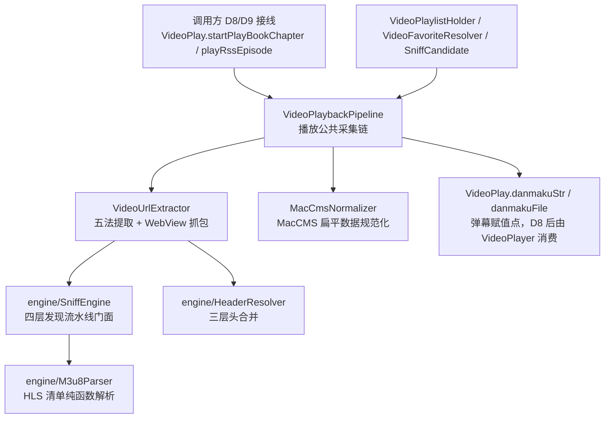

# D5 视频管线纯新增技术方案

Feature Name: d5-video-pipeline
Updated: 2026-10-15
清单编号: 2.1.3 视频管线
执行日: D5
源基准: m 源 `_refs/m` 锁定 commit `46dc93167ae67d8d912a0fb52352833cd922f15e`

## Description

D5 将 m 源 `help/video/` 视频采集链全套（10 文件）纯新增移植到工作区。该管线是 D4 融合方案的已确认前置：弹幕数据赋值点自工作区 `VideoPlay.kt:271` 迁至 `VideoPlaybackPipeline.kt`（D4 设计「环节 1：数据源赋值」），D8 以 m 版覆盖 `VideoPlay.kt` 时旧赋值点消失，管线必须先行就位。

核心约束为「纯新增 + 零覆盖旧文件」。实测依赖闭包后结论（含 `BackstageWebView.lastSniffCandidate` 惰性属性追加）：管线 10 文件对工作区 `io.legado.app` 符号的引用中，13 类可直接解析，缺口为 1 个缺失实体（`RssEpisode`）与 5 处既有文件缺成员（`EventBus`、`AppLog`、`ExoPlayerHelper`、`VideoPlay` × 6 成员、`BackstageWebView` × 2 构造参数）。本方案以「逐字搬运 + 最小支撑性追加 + 单点适配登记」三段式闭合缺口，D5 当日零覆盖任何既有代码行（既有文件仅尾部追加）。

## Architecture

### 管线在视频栈中的位置

### 管线内部采集链

`VideoPlaybackPipeline.playBookChapter(ctx)` 单一实现承载书源章节链与订阅源集链：直链判定（L0 快速路径）→ `WebBook.getContent` 采集 → MPD 文本落盘 → `VideoUrlExtractor` 三层嗅探 → `HeaderResolver.merge` 三层头合并 → 弹幕赋值 → `player.setUp` + `startPlayLogic`。切换令牌（`PipelineContext.token` vs `VideoPlay.currentSwitchToken`）守卫异步回调，过期丢弃。

### 依赖闭包核查结论（逐符号实测）

| 管线引用 | 工作区现状 | 处置 |
|----------|-----------|------|
| `AppLog.put` / `putDebug` | 已有 | 直用 |
| `AppLog.putWarn` / `putInfo` / `putDebugWithTag` | 缺失（m 为 Level 体系重写版） | 追加薄适配变体 |
| `EventBus.VIDEO_SUB_TITLE` | 已有 | 直用 |
| `EventBus.VIDEO_PLAY_ERROR` | 缺失 | 追加 1 行常量（m EventBus.kt:58） |
| `Book` / `BookChapter` / `BookSource` / `BaseSource` / `SearchBook` / `RssArticle` / `RssReadRecord` / `RssStar` | 已有且关键扩展齐备（`RssArticle.toStar/toRecord` L50/L66、`RssStar/RssReadRecord.toRssArticle` 与 m 逐字节一致） | 直用 |
| `RssEpisode` | 缺失 | 新增实体文件（纯 Parcelable） |
| `getDanmaku`（BookChapterExtensions） | 已有（D4 已证两侧一致） | 直用 |
| `Coroutine.async(scope, context)` | 已有 | 直用 |
| `ExoPlayerHelper`（object） | 已有 | 直用 |
| `ExoPlayerHelper.sanitizeUrl` | 缺失 | 追加 9 行自包含函数（m:1089） |
| `BackstageWebView.getStrResponse` | 已有 | 直用 |
| `BackstageWebView(interceptAllRequests=, videoSniffJs=)` | 缺 2 构造参数（m 增强 ~150 行） | 单点适配省略实参，融合登记至 D7 |
| `BackstageWebView.lastSniffCandidate` | 缺成员（m:88，嗅探上下文回传槽位） | 追加惰性属性（1 import + 1 属性，零写入点），写入逻辑随 D7 融合就位 |
| `AnalyzeUrl(url, source=, ruleData=, chapter=)` | 已有（4 个具名参数齐备） | 直用 |
| `WebBook.getContent(scope, bookSource, book, chapter)` | 已有（前 4 位参一致，m 的 video 分流在 WebBook 内部） | 直用 |
| `RuleDataInterface` | 已有 | 直用 |
| `VideoPlay.videoUrl / autoPlay / videoTempFile / loadScope / danmakuStr / danmakuFile` | 已有 | 直用 |
| `VideoPlay.resolvedChapterUrl / isLoadingFalse() / currentSwitchToken(+switchTokenCounter) / currentPlayHeaders / cachePlay` | 缺失 | 追加 6 成员（逐字取 m） |
| `FileUtils.createFileIfNotExist` / `MD5Utils.md5Encode` / `NetworkUtils.getAbsoluteURL` / `externalCache` / `postEvent` / `LogUtils` / `appCtx` / `GSYBaseVideoPlayer` / gson / jsoup | 已有 | 直用 |

## Components and Interfaces

### 新增文件清单（12 个，逐字搬运）

| # | 文件 | m 规模 | 角色 |
|---|------|--------|------|
| 1 | `help/video/VideoPlaybackPipeline.kt` | 295 行 | 播放公共采集链（书源章节链 + 订阅源集链唯一实现、弹幕赋值点新家） |
| 2 | `help/video/VideoUrlExtractor.kt` | 768 行 | R5 自动视频链接抓取器（①video 标签 ②OG/Meta ③script JSON ④JS 变量 ⑤正则五法 + WebView 抓包层） |
| 3 | `help/video/MacCmsNormalizer.kt` | object | MacCMS `vod_play_from/vod_play_url` 扁平数据 → routes/chapters 双结构增量注入 |
| 4 | `help/video/VideoFavoriteResolver.kt` | object | 收藏判定纯函数单源（禁止 Android 依赖，可 JVM 单测） |
| 5 | `help/video/VideoPlaylistHolder.kt` | object | 书源播放列表单例注入（跨影片续播，仿 RssSearchSourceHolder） |
| 6 | `help/video/SniffCandidate.kt` | data class | 嗅探候选（URL + 命中现场上下文头 + 命中层级 + 时序） |
| 7 | `engine/SniffEngine.kt` | object | 嗅探引擎门面（三意图共享四层发现流水线 + 去重缓存） |
| 8 | `engine/SniffModels.kt` | 3 模型 | SniffIntent / SniffRequest / SniffResult |
| 9 | `engine/HeaderResolver.kt` | object | 统一头收口（嗅探上下文 > 源配置 > CookieManager 三层 merge） |
| 10 | `engine/M3u8Parser.kt` | object | m3u8/HLS 清单纯函数解析（分片/多码率/AES-128 KEY/相对地址，与 HlsDownloader 等价迁移） |
| 11 | `data/entities/RssEpisode.kt` | 22 行 | 订阅源视频多集数据类（title/url/duration/cover，@Parcelize） |
| 12 | （唯一适配点）`VideoUrlExtractor.kt` L324 | 2 实参 | `BackstageWebView(...)` 省略 `interceptAllRequests`/`videoSniffJs`，注释标记 D7 恢复 |

### 支撑性追加清单（5 个既有文件，append-only）

| 文件 | 追加成员 | m 出处 | 适配说明 |
|------|----------|--------|----------|
| `constant/EventBus.kt` | `const val VIDEO_PLAY_ERROR = "videoPlayError"` | EventBus.kt:58 | 逐字 |
| `constant/AppLog.kt` | `Level` 枚举、`TAG_RSS` 常量、`putError` / `putWarn` / `putInfo`（三参签名同 m）、`putDebugWithTag(tag, message, throwable, level)` | AppLog.kt:29/enum Level/112-126/278 | m 版委托 `putEntry(msg, throwable, toast, Level)`，工作区无 Level 体系 → 薄适配：三级变体委托既有 `put()`；`putDebugWithTag` 对齐 m「tag 定向 logcat + recordLog 门禁 + 入列」语义（存储复用工作区 mLogs，截断用 `truncateForLog` 等价实现）。完整 Level 体系登记台账 |
| `help/exoplayer/ExoPlayerHelper.kt` | `fun sanitizeUrl(url: String): String` | ExoPlayerHelper.kt:1089 | 逐字（自包含，仅 java.net.URL + 字符串截断） |
| `model/VideoPlay.kt` | `var cachePlay`（@Deprecated，get 恒 false）、`internal fun isLoadingFalse()`、`private val switchTokenCounter = AtomicLong(0)` + `@Volatile var currentSwitchToken: Long = 0 (private set)`、`var currentPlayHeaders: Map<String, String>? = null`、`@Volatile var resolvedChapterUrl: String? = null` | VideoPlay.kt:340-352/465-471/476-481/510/568-574 | 逐字。`isLoadingFalse` 复用工作区既有 `isLoading` 字段（VideoPlay.kt:97 已存在，语义与 m 一致）；`cachePlay` 依赖的 `videoPrefs` 工作区已有（VideoPlay.kt:64）。追加位置：对象尾部统一追加区，标记 `[D5] 支撑性追加，D8 覆盖 VideoPlay.kt 时随融合消失` |
| `help/http/BackstageWebView.kt` | `var lastSniffCandidate: SniffCandidate? = null` + 1 条 import | BackstageWebView.kt:88 | 逐字属性声明，惰性（工作区无写入点）；`VideoUrlExtractor.kt:339` 的回传读取因此保持逐字。写入逻辑随 D7 融合就位 |

### 既有行修改白名单（零覆盖不变量的唯一豁免）

| 文件 | 行 | 修改 | 理由 |
|------|-----|------|------|
| `model/VideoPlay.kt` | L60 | `private val videoTempFile` → `internal val videoTempFile` | 管线 `VideoPlaybackPipeline.kt:122` 需访问（m 声明即 `internal`，VideoPlay.kt:89 逐字对齐）；可见性扩宽对对象内既有调用方零语义影响；D8 覆盖该文件时随融合消失。首轮构建实测唯一既有行修改 |

### 依赖台账修正与新增（对 D4 文档的增量）

1. **修正**：`RssEpisode` 搬运日 D8 → **D5**。原因：`VideoPlaybackPipeline.kt:10` 直接 import，管线编译硬依赖；非 Room 实体，提前零 DB 风险。`RssRoute` 维持 D8。
2. **新增**：`BackstageWebView` 视频嗅探增强融合 → **D7**。范围：构造参数 `interceptAllRequests`/`videoSniffJs` + `SnifferWebClient` 增量（`shouldInterceptRequest` 拦截分支、`onPageStarted` JS 注入、`onPageFinished` 读 `window.__videoUrls__` 兜底、`isVideoUrlPattern`/`deliverInterceptHit` 辅助，约 150 行，全部 default-off 门控）；完成时恢复 `VideoUrlExtractor.kt` L324 的 2 个实参。指派 D7 理由：D7 为依赖日且当日跑实库升级测试（有实机验证窗口），D8 起播放路径依赖嗅探全量能力。
3. **新增（低优先级）**：`AppLog` Level 体系完整升级 → 登记备查，阶段 1 回归（D11）前按需决策；D5 薄适配已覆盖管线与 D8-D10 视频栈编译需求。

## Data Models

- `PipelineContext`（`VideoPlaybackPipeline` 内嵌 data class）：scope / player(GSYBaseVideoPlayer) / source(BaseSource?) / token(Long) / title / displayTitle? / refererFallback? / ruleData(RuleDataInterface?) / book? / chapter? / article(RssArticle?)? / episode(RssEpisode?)? / onStarted?——书源链填 book+chapter，订阅源链填 article+episode。
- `SniffCandidate`：url + headers(Map) + source(命中层级枚举值) + timestamp；静态解析路径 headers 为空 map，消费端退化源配置兜底。
- `RssEpisode`：title/url/duration/cover 四字段全默认值，纯 Parcelable，无 Room 注解，不注册 AppDatabase。

## Correctness Properties

1. **零覆盖不变量**：`git diff` 相对基线仅含新增文件、5 个追加文件与白名单内 1 处可见性扩宽，其余既有行零变化。
2. **惰性不变量**：D5 后工作区既有代码对 `help.video` 包零引用（grep 证据），新增成员仅被新增代码调用。
3. **逐字不变量**：12 个新增文件中 11 个与 m 源逐字节一致，`VideoUrlExtractor.kt` 唯一差异为 L324 附近构造调用省略 2 实参 + 注释标记。
4. **签名一致不变量**：追加成员签名、默认值、注解与 m 声明一致，D8 覆盖 `VideoPlay.kt`/`AppLog.kt` 时无签名冲突。
5. **弹幕赋值点唯一性前置不变量**：管线的 `chapter.getDanmaku()` 分派（VideoPlaybackPipeline.kt:162-165）与工作区旧赋值点（VideoPlay.kt:271）在 D5-D8 窗口期并存，二者状态字段同源（`VideoPlay.danmakuStr/File`），D8 覆盖后收敛为管线唯一。
6. **DB 零变化不变量**：DB 版本保持 90，schema 目录、实体注册、迁移文件零变化。

## Error Handling

- **编译失败**：按依赖台账逐符号核对（本方案已实测闭合全部缺口）；若出现台账外缺失，按同模式追加并补记台账，禁止改动管线源文件。
- **回滚**：D5 全部产物为新增文件 + 4 处追加，`git revert` 单提交即完全回滚；工作区既有功能不受影响（惰性保证）。
- **D7 融合失败**：`BackstageWebView` 增强为 default-off 门控追加，失败仅回退增强部分，`VideoUrlExtractor` 维持 D5 适配形态（嗅探退化 onLoadResource 路径，D8 手测前必须闭合）。

## Test Strategy

| 项 | 验证 | 方式 |
|----|------|------|
| 编译完整性 | `./gradlew :app:assembleDebug` 通过 | 构建日志留存 |
| 零覆盖核查 | `git diff --stat` 仅 4 个 M 文件（均为追加）+ N 个新增文件 | diff 审计 |
| 逐字核查 | 11 个新增文件与 `_refs/m` 对应文件 `diff` 为空；`VideoUrlExtractor.kt` 差异仅适配点 | diff 审计 |
| 惰性核查 | 工作区既有源码 grep `help.video` 零命中（新增文件自身除外） | grep 审计 |
| DB 零变化 | AppDatabase version 仍为 90，schemas 目录无新文件 | 核对 |
| 功能验证 | D5 无功能手测项（管线未被调用）；嗅探/播放功能验证顺延至 D7（BackstageWebView 融合 + 实库升级测试）与 D8-D10 | 排期约束 |

## References

[^1]: (Filename#L162) - `_refs/m/app/src/main/java/io/legado/app/help/video/VideoPlaybackPipeline.kt` 弹幕赋值点
[^2]: (Filename#L324) - `_refs/m/.../help/video/VideoUrlExtractor.kt` BackstageWebView 构造调用（D5 唯一适配点）
[^3]: (Filename#L1089) - `_refs/m/.../help/exoplayer/ExoPlayerHelper.kt` sanitizeUrl 自包含实现
[^4]: (Filename#L58) - `_refs/m/.../constant/EventBus.kt` VIDEO_PLAY_ERROR 常量
[^5]: (Filename#L97) - 工作区 `model/VideoPlay.kt` 既有 isLoading 字段（isLoadingFalse 适配依据）
[^6]: (Filename#L271) - 工作区 `model/VideoPlay.kt` 旧弹幕赋值点（D5-D8 并存窗口参照）
[^7]: (Filename#L455) - `_refs/m/.../help/http/BackstageWebView.kt` shouldInterceptRequest 增强实现（D7 融合范围）
