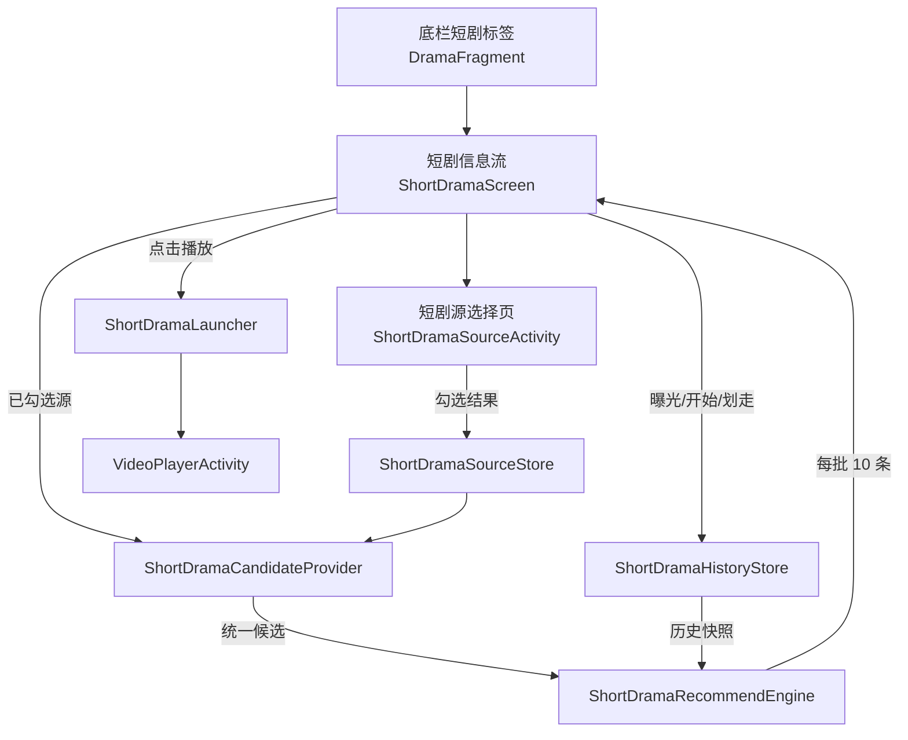

# 短剧信息流

Feature Name: short-drama-feed
Updated: 2026-11-19

## Description

在底栏「短剧」位提供整屏竖向滑动的短剧消费场景。内容来源为已导入的四类源（视频书源、订阅源、PY 源、TVBOX 源），由用户在短剧源选择页勾选；播放复用既有 `VideoPlayerActivity`，推荐只做去重与轻量排序，不做相似召回。

## Architecture



数据流：用户勾选源 → 提供者并发拉取各源条目并归一化为 `DramaCandidate` → 引擎按历史快照去重排序 → 信息流每批 10 条追加 → 播放交给既有播放器 → 行为写回历史表影响下一批。

## Components and Interfaces

### ShortDramaSourceStore（`data/drama`）

- 只保存「哪些源被勾选」，源配置仍由各自管理页维护；偏好键 `short_drama_sources`，值为 `kind:key` 集合。
- `available(kind)` 列出该类别全部可选源：
  - 书源：`bookSourceDao.allEnabledPart` 中 `bookSourceType == BookSourceType.video`
  - 订阅源：`rssSourceDao.allEnabled`
  - PY / TVBOX：`VideoSourceRegistry.listSources()`，按 `SourceType.PY` 与其余类型分组
- `enabled()` 返回勾选项与现存源的交集，删除源后自动失效。

### ShortDramaCandidateProvider（`data/drama`）

- 每源一个协程，`withTimeoutOrNull(15s)` 隔离慢源，`runCatching` 隔离失败。
- 视频源：`createSource(info).home()`，取前 20 条；`seriesId = video:<sourceKey>:<itemId>`；标签取备注切分词 + 源名；集数由备注「N集/话」解析。
- 订阅源：`rssArticleDao.getLatestByOrigin(origin, 10)` 读本地缓存，不触发刷新；`seriesId = rss:<origin>:<link>`；标签取分组名 + 源名。
- 书源：读取 `exploreKindsJson()` 第一个 url 类型入口，`WebBook.exploreBookAwait` 取第一页 20 条；`seriesId = book:<sourceKey>:<bookUrl>`；标签取 `kind` 切分。
- 输出按 `seriesId` 去重并截断到上限。

### ShortDramaRecommendEngine（`data/drama`，纯 Kotlin）

输入 `List<DramaCandidate>` + `DramaHistorySnapshot` + 会话状态，输出 `DramaRankResult`。

```text
score = 0.5 * preference + 0.2 * freshness + 0.15 * (1 - completePenalty) + 0.15 - skipPenalty
preference      = max(tagScore[tag])                         // 0..1，取候选最强标签
freshness       = clamp(1 - ageHours / 168, 0, 1)             // 未知发布时间取 0.5
completePenalty = 1 - elapsed / 7d                            // 7 天内完播
skipPenalty     = 0.3                                        // 本会话被划走
```

约束：

1. 批次内与当前信息流内 `seriesId` 唯一
2. 严格轮排除 24 小时内已曝光系列
3. 同源占比不超过 50%，同源连续不超过 2 条，同标签连续不超过 3 条
4. 严格轮不足时放宽曝光窗口重跑一次，仍不足则标记 `supplement = true`
5. 相同输入产生相同输出，便于 JVM 单测

### ShortDramaHistoryStore（`data/drama`）

- 写入 `shortDramaInteractions`，`action ∈ {exposure, start, progress, complete, skip}`。
- 每次写入后 `trimTo(5000)`，避免长期累积。
- `snapshot()`：24 小时曝光集合、7 天完播表、30 天标签偏好、最近曝光源。
- 偏好：`0.6 * 平均完成率 + 0.4 * 标签出现占比`；完成率取 `position/duration`，完播计 1.0。

### ShortDramaScreen / DramaFragment（`ui/main/drama`）

- `DramaFragment` 保持既有 `MainFragmentInterface`，内容为 `ShortDramaScreen`。
- 状态：加载中、无源引导、空结果、信息流四种；无源引导提供「选择短剧源」入口。
- `VerticalPager` 一屏一条：封面铺满 + 底部渐变信息区（标题、源名、集数、标签）+「立即观看 / 不感兴趣」+ 右上角源管理按钮。
- `snapshotFlow { currentPage }` 触发曝光记录，接近末尾 3 条时 `loadMore()`。
- `LifecycleResumeEffect` 在回到页面时比对勾选变化，有变化才重建信息流。
- 底栏双击「短剧」回到首条（`scrollToTopTick` 触发 `animateScrollToPage(0)`）。

### ShortDramaLauncher（`ui/main/drama`）

- PY / TVBOX：传 `pyPluginId` + `pyVideoItemId`，播放页自行 `detail` + `play` 并生成集数列表。
- 订阅源：先 `ReadRss.prepareVideoPlayContext(article, null)` 补上下文，再以 `sourceType=rss` + `record` 打开。
- 书源：传 `bookUrl`，走既有书源播放链路。

## Data Models

```kotlin
enum class DramaSourceKind(val label: String) { BOOK, RSS, PY, TVBOX }

data class DramaSourceRef(val kind: DramaSourceKind, val key: String, val name: String)

data class DramaCandidate(
    val seriesId: String,
    val source: DramaSourceRef,
    val title: String,
    val cover: String = "",
    val tags: List<String> = emptyList(),
    val itemId: String = "",
    val pageUrl: String = "",
    val flag: String = "",
    val episodeCount: Int = 1,
    val publishedAt: Long = 0L,
)
```

Room 表（数据库 98 → 99，`AutoMigration`）：

```kotlin
@Entity(
    tableName = "shortDramaInteractions",
    primaryKeys = ["seriesId", "action", "timestamp"],
    indices = [Index("timestamp"), Index("sourceId"), Index("seriesId")],
)
data class ShortDramaInteraction(
    var seriesId: String = "",
    var sourceId: String = "",
    var episodeId: String = "",
    var action: String = "",
    var tags: String = "",
    var position: Long = 0L,
    var duration: Long = 0L,
    var timestamp: Long = System.currentTimeMillis(),
)
```

## Correctness Properties

1. 批次内与信息流内 `seriesId` 不重复。
2. 严格轮不返回 24 小时内已曝光系列；补充轮仍排除本会话已曝光与当前信息流条目。
3. 返回条数不超过 `limit`，`supplement` 仅在严格轮不足时为真。
4. 单源失败或超时不阻断整批；无勾选源时进入引导态。
5. 删除或停用源后，该源条目不再出现在后续批次。
6. 引擎为纯函数，相同输入产生相同输出。

## Error Handling

| 场景 | 处理 |
| --- | --- |
| 单源超时（15s）或异常 | 记录日志并跳过该源，其余源照常出结果 |
| 全部源无结果 | 空态提示「所选源没有返回内容」，提供重选源与重新加载 |
| 未勾选任何源 | 引导态，提供「选择短剧源」 |
| 记录写入失败 | `runCatching` 包裹，仅记日志，不阻断浏览 |
| 播放页缺少上下文 | 订阅源先补 `VideoPlay` 上下文，书源传 `bookUrl`，避免空指针式静默失败 |
| js/源被删除 | `enabled()` 取交集，条目自然消失 |

## Test Strategy

- JVM 单测 `app/src/test/java/io/legado/app/data/drama/ShortDramaRecommendEngineTest.kt`：
  - 24 小时窗口排除、当前信息流去重、完播降序、单源占比、补充轮放宽且仍去重、空输入、标签偏好提升分数、同源连续约束、多源稳定性
- 手工真机验证：竖滑流畅度、点击进入播放、划走后不再出现、源变更后信息流重建、空态引导。
- 现有全量单测存在与本功能无关的 `JsTest` 栈溢出失败，作为已知噪声。

## References

[^1]: (app/src/main/java/io/legado/app/data/video/VideoSource.kt) - 统一视频源接口
[^2]: (app/src/main/java/io/legado/app/data/video/VideoSourceRegistry.kt) - 源注册表与 `createSource`
[^3]: (app/src/main/java/io/legado/app/ui/video/VideoPlayerActivity.kt) - `pyVideoItemId` 解析与 `sourceType=rss` 播放
[^4]: (app/src/main/java/io/legado/app/ui/rss/read/ReadRss.kt) - `prepareVideoPlayContext`
[^5]: (app/src/main/java/io/legado/app/ui/book/explore/ExploreShowActivity.kt) - 视频书源 `bookUrl` 播放入口
[^6]: (app/src/main/java/io/legado/app/data/AppDatabase.kt) - 版本 99 与 `AutoMigration(98, 99)`