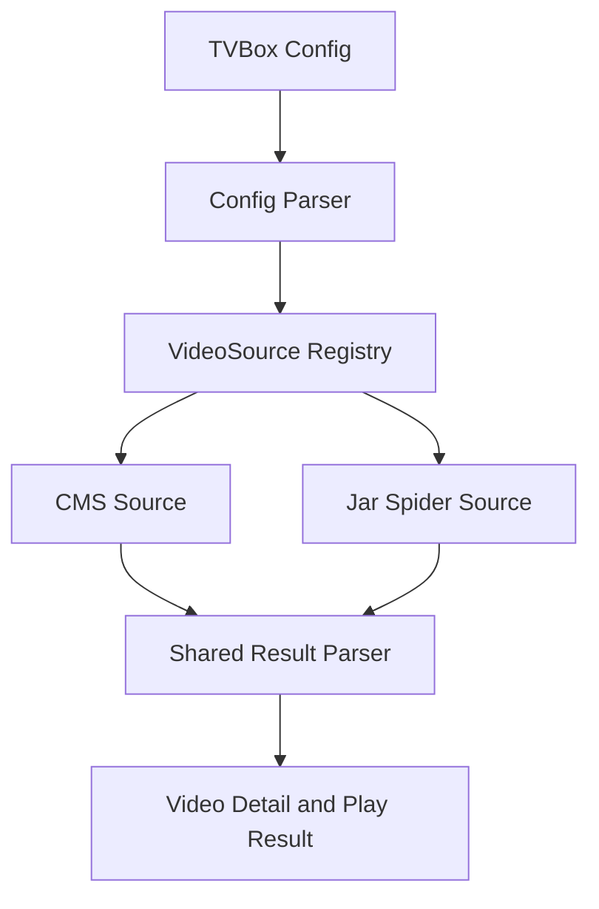

# TVBox Parser Chain

Feature Name: tvbox-parser-chain
Updated: 2026-11-16

## Description

统一 CMS 与 FongMi Spider 的详情线路、播放结果和请求头解析，并保留 TVBox Config 的原始协议字段。

## Architecture

`TvBoxResultParser` 负责协议层字段归一化。`JsonVideoSource` 和 `JarVideoSource` 继续负责请求与源生命周期，统一解析器负责共享详情线路和播放结果规则。

## Components and Interfaces

- `PyHomepageViewModel.importTvboxSource`: 保存完整订阅 JSON。
- `FongMiConfigParser`: 识别站点形态并展开站点配置。
- `TvBoxResultParser.parsePlay`: 解析嵌套/顶层播放 URL、请求头和 `parse`。
- `TvBoxResultParser.parsePlayLines`: 解析 CMS 多线路字符串和直接线路数组。
- `JsonVideoSource` / `JarVideoSource`: 使用共享解析器创建统一 `VideoDetail` 和 `PlayResult`。

## Correctness Properties

- 每个完整播放项包含非空 URL。
- `parse=0` 在统一播放结果中保持为 0。
- `header`、`headers` 和 `headerInfo` 经过同一格式解析规则。
- Config 导入前后的协议字段保持可供源注册表重新读取。

## Error Handling

接口请求失败继续抛出包含源类型和请求地址的异常。播放 JSON 无法解析时使用原始播放值作为 URL 回退，保留默认 `parse=-1`。

## Test Strategy

- JVM 单测覆盖嵌套 `playUrl`、多格式请求头和 `parse`。
- JVM 单测覆盖 CMS `$$$/#/$` 多线路和直接 `play_lines`。
- Python 兼容测试继续覆盖 Spider 接口结果归一化。
- Android Debug 构建验证 Kotlin 编译和资源处理。
