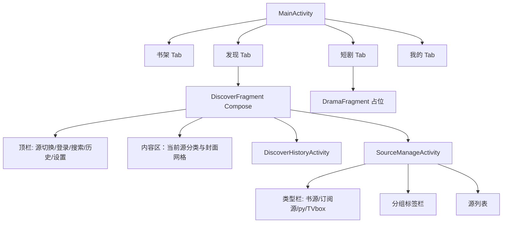

# Unified Navigation and Source Management Design

Feature Name: unified-navigation-source-management
Updated: 2026-11-19

## Description

将底部导航收敛为四 Tab（书架、发现、短剧、我的）。发现 Tab 合并书源、订阅源、首页三块内容，采用首页源式顶栏（源名称切换 + 登录/搜索/历史/设置）。新建统一源管理 Activity，顶部类型栏切换书源/订阅源/py/TVbox，第二栏分组标签栏管理全部源。短剧 Tab 为空白占位。

## Architecture

## Components and Interfaces

### Navigation

- `main_bnv.xml`: 四项菜单（书架、发现、短剧、我的），新增 `menu_drama`。
- `AppConfig.navItemOrder`: 默认改为 `listOf("bookshelf", "explore", "drama", "my")`。
- `MainActivity`:
  - 新增 `idDrama = 5`，`realPositions = arrayOf(idBookshelf, idExplore, idDrama, idMy)`，`bottomMenuCount = 4`。
  - `fragmentIdToMenuItemId` 增加 `idDrama -> R.id.menu_drama`。
  - `upBottomMenu` 增加 `"drama"` 分支。
  - `TabFragmentPageAdapter.getItem` 增加 `idDrama -> DramaFragment(position)`。
  - `getItemPosition` 增加 `idDrama && DramaFragment`。

### DiscoverFragment（发现 Tab）

Compose 承载，复用首页源顶栏模式：

- 顶栏：源名最多十字，超出加 `...`，依次排列有条件显示的登录、搜索、观看历史、设置。源选择器使用居中 Compose Dialog，紧凑搜索框、横向类型与分组栏、两列源名，并将当前源置顶。设置接入书源/RSS 编辑、统一源管理、本地 PY 导入、书源/RSS 网络链接导入、TVbox 接口和弹幕 API 配置。
- 当前源持久化到偏好设置，键使用带类型的源 key；源删除或禁用后回退到首个可用源并同步持久化。登录入口使用加粗线条的人物图标（`ic_login_person_bold`），不复用底部导航图标。选择器源名与切换箭头紧邻，搜索框布局高度需容纳完整输入文字。
- Discover 的历史入口应聚合全部书籍阅读记录和所有 RSS 源阅读记录；保留现有各类记录的阅读路由。
- `DiscoverHistoryActivity` 将按书名聚合的书籍阅读记录与 RSS 已读记录按最近阅读时间降序合并；书籍点击打开本地书籍或回退到搜索，RSS 点击复用 RSS 历史回放入口。单条删除按记录类型操作，清空操作覆盖两类历史。
- 内容区随顶栏当前源切换：
  - 书源与 RSS 内容使用三列 3:4 封面，横向间距 8dp、纵向 4dp。书名/文章标题显示在封面下方；书源作者显示在封面左上角白字并使用顶部渐变，书源最新章节与 RSS 发布时间显示在右下角白字并使用底部渐变。RSS 轻量查询包含图片字段。
  - 视频书目进入播放器，其余书目进入详情页。RSS 按来源类型打开，配置 `startHtml` 时在发现页内显示首页 WebView，并通过 MainActivity 暂时隐藏主底部导航。
  - 首页源显示复用的分类标签、视频网格或 WEB HTML。
   - 列表近底分页，分页错误保留当前内容并以通用提示展示重试操作；不向发现页展示技术异常详情。
    - RSS `PAGE` 与 URL 页码占位模式允许分页重复请求同一基础 URL，同时增加请求页码；默认 XML 文章解析分支同时解析显式下一页规则并返回后续地址。
    - 订阅源翻页：`DiscoverRssViewModel.loadNextPage` 直接以解析器返回的 `followingUrl` 作为下一页地址，不按已访问 URL 集合拦截；翻页请求返回的新增文章为空时才停止翻页，死循环防护与文章页翻页一致（代价至多一次重复请求）。`loadNextPage` 落库后在内存以 `(articles + additions).distinctBy` 合并追加，列表即时增长、滚动位置不重置，与书源 `books = books + additions` 的翻页表现一致；`RssContent` 分页 effect 的结束判定对齐书源：仅以页码是否推进为准。
    - 分类浏览位置按分类记录并恢复：分类键为 `book:`/`rss:`/`home:` 前缀加当前源 key 与分类标识，坐标缓存首个可见条目下标；记录点在离开分类的瞬间（`DisposableEffect(categoryKey).onDispose` 读取旧网格的 `firstVisibleItemIndex`），因为切换分类会重建 `LazyGridState`，只有此刻还能读到旧分类的准确下标，同时避开「布局仍是上一分类内容」的瞬时帧；缓存提升到 `DiscoverScreen` 层持有，切换源时清空全部缓存；`DiscoverFragment.setUserVisibleHint(false)` 在切走发现 Tab 时清空缓存，保证位置记录仅在当前源发现有效。恢复时若缓存下标超出已加载条目数（分页内容从第 1 页重新加载），先把网格滚到已加载末尾以触发自动翻页，等目标下标可达后再精确定位；加载失败或多次等待超时则放弃恢复。分类之间互不影响位置：滚动状态按分类键创建（`remember(categoryKey) { LazyGridState() }`），切换分类时得到全新状态，再从该分类缓存恢复首个可见条目；旧分类下标不会带入新分类。

数据来源：
- `DiscoverViewModel` 从书源和 RSS DAO 及 `HomeSourceManagementStore` 聚合启用源，使用带类型的键区分相同源 ID。
- 首页内容复用 `PyHomepageViewModel` 的 `homeData` / `categoryData`。

### SourceManageActivity（统一源管理）

新建 Activity，Compose 实现：

- 顶部类型栏：全部、书源、订阅源、py、TVbox。「全部」位于书源之前并默认选中，聚合四类全部源。
- 视觉沿用「我的」中书源管理列表样式；在列表前增加类型栏与分组栏，保留统一管理 Scaffold 的搜索、批量选择和批量操作。
- 第二栏分组标签栏：显示当前类型的分组，点击筛选；每类独立保存筛选状态。「全部」下分组名跨类型合并去重，点击分组展示所有类型中属于该分组的源。
- 源列表与顶栏沿用书源管理样式。书源/RSS 行提供选择、名称、启用、编辑与置顶/置底/删除菜单；PY/TVBOX 行提供选择、名称、启用、删除与置顶/置底菜单。「全部」下不提供置顶/置底与长按拖动排序，批量分组按行所属类型分别写入。行内隐藏 URL、独立拖动把手与分组编辑文案，分组继续由类型分组栏和批量分组入口操作。整行长按拖动排序并持久化；全选按钮切换全选/取消可见项。首页源启用状态与顺序由管理 Store 持久化，书源/RSS 顺序复用 `customOrder`。
- 批量分组入口可选择现有分组、创建分组或移至未分组；书源和 RSS 使用 Room 实体，首页源使用 `HomeSourceManagementStore` 元数据。
- TVbox 管理包含 HTML、JSON、TXT、JAR、CONFIG 与独立 WEB 首页源。
  - 书源 → `BookSourceEditActivity`
  - 订阅源 → `RssSourceEditActivity`
   - py/TVbox → 当前源详情；分组操作在本页完成。

展开的 TVbox 站点以父配置和站点标识记录删除状态。注册表过滤已删除的站点，父配置及其余站点继续可用。

### SearchActivity（四类型搜索）

- 保留现有书源搜索。`UnifiedSearchViewModel` 调度 RSS、py 和 TVbox 的首页结果，支持选择单源或全部可搜索源。
- 类型栏置于类型/分组区域，位于「精准搜索/多组搜索/高级筛选」一行下方、分组栏上方，随列表滚动上移；书源标签显示为 `BOOK`。类型栏与分组栏共用胶囊按钮样式，选中胶囊文字为白色。
- 类型栏首项为 `ALL`，聚合 RSS、PY、TVBOX 三类源一起搜索；其后为 `BOOK`、`RSS`、`PY`、`TVBOX`。`ALL` 的分组栏取三类源分组并集。
- 搜索页只有一页：切换类型不打开新页面，只切换下方分组栏到该类型的分组（书源分组、订阅源分组、PY/TVBOX 首页源分组），搜索结果区域随之替换为该类型的结果；分组栏首项固定为「全部」。
- 分组筛选按类型生效：书源沿用搜索范围；订阅源按 `sourceGroup`、PY/TVBOX 按首页源管理中的分组指派过滤 `UnifiedSearchViewModel` 的搜索源；单源选择优先级高于分组。
- 搜索页不展示独立的「搜索范围」提示行；书源专属的推荐、视图与设置入口仅在书源类型显示。
- 每个源独立处理超时和失败。取消任务和请求版本共同隔离旧结果。点击结果沿用对应的阅读或播放入口。

### DramaFragment（短剧占位）

Compose 实现，显示「短剧功能开发中」占位文案，无其他交互。

## Data Models

- 源类型枚举：`BOOK`（书源）、`RSS`（订阅源）、`PY`（py 源）、`TVBOX`（TVbox 源）。
- 统一源项：`DiscoverSourceItem` 聚合书源、RSS 与首页源切换字段；具体内容分别由书源、RSS 与首页 ViewModel 加载。

## Correctness Properties

- 四 Tab 顺序固定，不可通过配置调整（移除可配置排序，简化为固定顺序）。
- 发现页顶栏登录按钮仅在当前源 `hasLoginUrl` 为真时显示。
- 源管理页类型栏切换不丢失分组筛选状态。

## Error Handling

- 发现页源加载失败：显示空态提示，不崩溃。
- 源管理页某类型无源：显示空态提示。
- 首页内容加载失败：显示错误文案。

## Test Strategy

- 单元测试：`DiscoverViewModel` 源聚合逻辑、分组筛选逻辑。
- 编译验证：`assembleDebug` 通过。
- 人工验证：四 Tab 切换、发现页顶栏交互、源管理页类型/分组切换。
