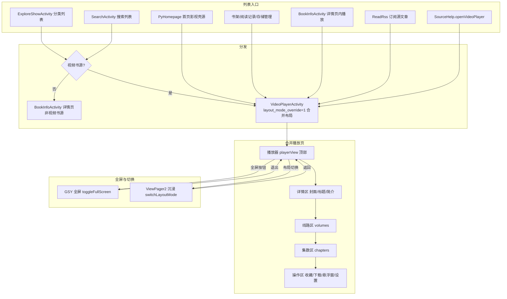

# 视频书源合并播放页（详情+播放合并，列表直达）

Feature Name: video-merged-detail-play
Updated: 2026-11-12

## Description

将视频类书源与首页影视壳源的「详情页」与「播放页」合并为单一页面：播放器固定于页面顶部，详情信息（封面、标题、简介）、播放源线路与合集选集同页纵向滚动。针对视频类书源与首页影视壳源，分类/搜索列表点击直接进入合并播放页，跳过 BookInfoActivity 详情页中间跳转；书架、阅读记录、存储管理、详情页内播放、订阅源文章播放等全部入口统一按合并布局呈现。合并页保留全屏沉浸入口（现有 GSY 全屏 + ViewPager2 沉浸模式切换）。

实现方式：复用 VideoPlayerActivity 现有传统合并布局（layoutMode=1），通过 intent 布局模式覆盖（`layout_mode_override`）强制合并布局，不新建独立 Activity，复用全部播放功能（收藏/下载/悬浮窗/设置/弹幕/DLNA/上一部下一部）。

## Architecture



## Components and Interfaces

### 1. VideoPlayerActivity（布局模式覆盖）

- **新增字段** `layoutModeOverride: Int = -1`（-1=未传，0=沉浸，1=合并）
- **新增 intent extra** `layout_mode_override`（Int）：由各入口传入，仅作用于本次会话
- **`initFromIntent()`**：读取 `layout_mode_override` extra，存入 `layoutModeOverride` 字段
- **`dispatchLayoutMode()`**：分发时取 `layoutModeOverride.takeIf { it in 0..1 } ?: VideoPlay.layoutMode`，优先使用 intent 覆盖
- **`switchLayoutMode(targetMode)`**：用户主动切换时清空 `layoutModeOverride = -1` 并写 `VideoPlay.layoutMode` 持久化（保留用户偏好，不被一次性 intent 污染）
- 文件：`app/src/main/java/io/legado/app/ui/video/VideoPlayerActivity.kt`（initFromIntent / dispatchLayoutMode / switchLayoutMode）

### 2. 入口改造（全部启动点传合并布局标记）

常量定义于 `PreferKey` 或 VideoPlayerActivity 伴生：

```kotlin
const val EXTRA_LAYOUT_MODE_OVERRIDE = "layout_mode_override"
const val LAYOUT_MODE_MERGED = 1
```

启动点改造清单（均在 `startActivity<VideoPlayerActivity>` 的 configIntent 中加 `putExtra(EXTRA_LAYOUT_MODE_OVERRIDE, LAYOUT_MODE_MERGED)`）：

| 入口 | 文件:位置 | 改造 |
|------|----------|------|
| 书架/阅读记录/存储管理等 | `ContextExtensions.kt:startActivityForBook` | 视频书源分支加 extra |
| Fragment 版书架入口 | `FragmentExtensions.kt:startActivityForBook` | 视频书源分支加 extra |
| 详情页内开始播放 | `BookInfoActivity.kt:startReadActivity` 视频分支 | 加 extra |
| 首页影视壳源 | `PyHomepageViewModel.kt:playVideo` | 加 extra |
| 源详情打开播放器 | `SourceHelp.kt:openVideoPlayer` | 加 extra |
| 订阅源文章播放 | `ReadRss.kt`（两处启动） | 加 extra |
| 悬浮窗全屏恢复 | `VideoPlayService.kt` | 保持现状（全屏场景） |

### 3. 列表直达改造（视频书源跳过详情页）

- **`ExploreShowActivity.showBookInfo(book)`**（分类列表）：当 `book.isVideo` 为真时，直接启动 VideoPlayerActivity（`bookUrl` + `inBookshelf` + 合并布局 extra），不再进入 BookInfoActivity；非视频书源维持现状。
- **`SearchActivity.showBookInfo(...)`**（搜索列表）：同样按 `book.isVideo` 分流直跳。

### 4. 合并布局 UI 优化（贴近截图形态）

现有 legacy 合并布局（`activity_video_player.xml` legacyContainer）已具备播放器+详情+线路+集数结构，做以下适度优化：

- 详情区：封面小图 + 标题 + 简介（保留现有结构，样式对齐截图详情卡）
- 集数区：保持纵向列表（截图 chips 样式可选优化，书源集数较多时列表更实用，不强制复刻）
- 操作区：保留现有 下载/收藏/上一部/下一部/悬浮窗/设置 六按钮

## Data Models

- `layout_mode_override`：Intent extra，Int。-1 未传 / 0 沉浸 / 1 合并。会话级，不持久化。
- `VideoPlay.layoutMode`：持久化布局偏好（0/1），用户主动切换时更新，保持既有设置面板语义不变。

## Correctness Properties

1. **偏好不污染**：intent 传入的布局覆盖仅作用于本次会话，不得写入 `VideoPlay.layoutMode` 持久化；用户经设置面板主动切换时清覆盖并持久化。
2. **直达不丢上下文**：分类列表直跳 VideoPlayerActivity 时，`bookUrl` 与 `inBookshelf` 必须完整传递，书架状态判断与详情页路径一致。
3. **播放链路等价**：合并布局下的书源/影视壳源/订阅源播放、选集、切线路、上一部下一部、收藏、下载、设置、弹幕能力与沉浸式等价，不因布局合并引入功能缺失。
4. **全屏衔接**：合并页全屏退出后信息区（详情/线路/集数）与操作区完整恢复，播放进度不丢失。
5. **非视频链路零影响**：音频/图片/普通书源跳转、非视频列表条目详情页，全部维持既有行为。

## Error Handling

1. **initSource 失败**：维持现有 `finish()` 行为与日志（`VideoPlayerActivity.initFromIntent`），合并布局不改变失败处理。
2. **视频书源数据加载失败**：列表直跳进入合并页后若目录加载失败，播放器展示既有错误提示（换线路自愈或错误框），不回退详情页（详情页已非视频书源入口）。
3. **布局模式覆盖值非法**：extra 值不在 0/1 时按未传（-1）处理，回退持久化偏好。
4. **VideoPlayService 全屏恢复**：不传布局覆盖，按持久化偏好分发，避免全屏场景布局漂移。

## Test Strategy

1. **编译验证**：`./gradlew :app:assembleRelease -x lint -x lintVitalAppRelease -x test`，后台终端执行。
2. **真机验证**（用户反馈）：
   - 分类列表视频书源点击 → 合并播放页直达、起播、选集、切线路
   - 搜索列表视频书源点击 → 合并播放页直达
   - 首页影视壳源点击 → 合并播放页、集数列表点选
   - 书架/阅读记录视频书源点击 → 合并播放页
   - 详情页（BookInfoActivity）内视频书源开始播放 → 合并播放页
   - 订阅源文章播放 → 合并播放页
   - 合并页全屏进入/退出 → 信息区恢复、进度衔接
   - 设置面板布局切换 → 偏好持久化、覆盖清空
   - 非视频书源/音频/图片链路回归

## References

[^1]: `app/src/main/java/io/legado/app/ui/video/VideoPlayerActivity.kt` - 双布局分发（dispatchLayoutMode/setupLegacyMode/switchLayoutMode/toggleFullScreen）
[^2]: `app/src/main/res/layout/activity_video_player.xml` - legacyContainer 合并布局结构（playerView + legacy_scroll[data/chapters] + legacy_actions）
[^3]: `app/src/main/java/io/legado/app/ui/book/explore/ExploreShowActivity.kt` - 分类列表 showBookInfo 分流点
[^4]: `app/src/main/java/io/legado/app/ui/book/search/SearchActivity.kt` - 搜索列表 showBookInfo 分流点
[^5]: `app/src/main/java/io/legado/app/ui/main/homepage/PyHomepageViewModel.kt` - 首页影视壳源 playVideo
[^6]: `app/src/main/java/io/legado/app/utils/ContextExtensions.kt` / `FragmentExtensions.kt` - startActivityForBook 视频分支
[^7]: `app/src/main/java/io/legado/app/help/source/SourceHelp.kt` - openVideoPlayer
[^8]: `app/src/main/java/io/legado/app/ui/rss/read/ReadRss.kt` - 订阅源文章播放启动
